# Wrong Shell: Threat Hunt on a Hijacked Windows Workstation

    

A threat hunt I ran in a cyber range lab (LOG(N) Pacific, workspace `LAW-HuntPractice`). I traced an intruder on one Windows workstation from a single alert ("strange web traffic") back to how they got in and forward to everything they did, then wrote and tested detections for each step.

> **Lab data.** Every host, user and address here comes from a training range, not a real company.

📄 **Full report:** [WrongShell_Report.pdf](WrongShell_Report.pdf) (28 pages: executive summary, timeline, findings, detections with test results, gaps, response plan, claim register, all queries and every exhibit).

---

## Contents

- [The short version](#the-short-version)
- [What happened, step by step](#what-happened-step-by-step)
- [How I found it](#how-i-found-it)
- [Key evidence](#key-evidence)
- [Where the data disagreed with the brief](#where-the-data-disagreed-with-the-brief)
- [Detections I wrote and tested](#detections-i-wrote-and-tested)
- [What should change](#what-should-change)
- [MITRE ATT&CK mapping](#mitre-attck-mapping)
- [Indicators](#indicators)
- [Repository layout](#repository-layout)
- [What I learned](#what-i-learned)

---

## The short version

**Think of it like this.** Someone steals a worker's office key card, walks in through a side door that faces the street, and leaves a small radio hidden in a drawer labelled "printer supplies". Over the afternoon they use the radio to read a notebook of passwords, try and fail to get into the manager's office, copy two files, and finally tape a second radio under the desk so it switches on the next time the worker arrives.

**In technical terms:**

- An outsider signed in to `sarah.cole`'s workstation **NL-WS01** over **Remote Desktop**, which was open to the internet, using her **real password**. Their computer still called itself `kali`.
- They launched **`svchost1.exe`** from the Downloads folder: a beacon dressed up as the Windows service `svchost.exe`, calling home to `egravy[.]com` over plain HTTP on port 80.
- A **human operator** worked through it for five hours: typed the Linux command `ls` on Windows, made a typo, and **failed three times** to become an administrator.
- They read **`passwords.txt`** and pulled it and **`vpn-access-notes.txt`** back through the beacon.
- They hid a second copy as **`Pictures\picture-loader\imageloader.exe`** with a registry **Run key** called `image`, so it would restart at the next logon.
- **No spread** to other machines. **Not contained** when the hunt window closed.

The busy part: during the hunt window the same Remote Desktop port took **3,792 connections from 32 internet addresses**, and the host logged **6,986 failed logons** between midnight and 17:00, mostly password spraying against `Administrator`. The attacker made **one** connection and got in on the first try. The noise was a smokescreen they didn't even need.

---

## What happened, step by step

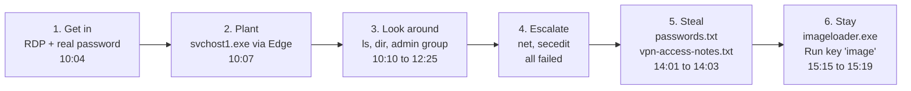

All times UTC, 15 October 2026. The portal shows local time (UTC-4), so I added 4 hours to every screenshot time.

| Time (UTC) | What happened |
|---|---|
| 10:01 | The real user connects from her own computer, `DESKTOP-AMOL2RQ`, and opens `passwords.txt` in Notepad |
| 10:04:21 | `187.15.135[.]77` opens its **only** connection to Remote Desktop |
| 10:04:22 / 10:04:29 | Logs on as `sarah.cole` (client name `kali`), then a Remote Desktop session (logon type 10) |
| 10:07:52 | `svchost1.exe` starts from Downloads, launched by Microsoft Edge |
| 10:10:50 | The Administrators group is listed |
| 12:15 to 12:16 | `net localgroups ... /add` (typo), then the correct command: both denied |
| 12:20 to 12:25 | `ls` twice (Linux habit), then `dir` four times while fixing the path |
| 14:01:10 | `type passwords.txt` through the beacon |
| 14:01:35 | `secedit /configure` to rewrite user rights: denied |
| 14:02 to 14:03 | `download` on `passwords.txt` and `vpn-access-notes.txt` |
| 15:15 to 15:19 | Drops `sishelper.exe`, deletes it, checks it is gone, makes `picture-loader`, drops `imageloader.exe`, sets the Run key |
| 17:00 | Window closes. No Run key removal, no password reset, `imageloader.exe` never started yet |

---

## How I found it

The alert said "unusual outbound HTTP". I started there and asked one question at a time.

| Question | Where I looked | What I found |
|---|---|---|
| Which program makes the traffic? | `SysmonNetwork_CL` grouped by process | Only `svchost1.exe` in Downloads talks out on port 80 (27 connections) |
| Where does it call? | `SysmonDNS_CL` | `egravy[.]com`, resolving to two addresses |
| Is it really svchost? | `SysmonProcess_CL` | Wrong folder, wrong parent (Edge), wrong user, session 2 instead of 0 |
| Who was on the machine? | `SecurityEvent_CL` 4624 | `kali` from `187.15.135[.]77`, then a type 10 (Remote Desktop) logon |
| Did they guess the password? | 4625 failures + port 3389 sources | No. One connection, no failures from that address |
| What did they type? | Child processes of the beacon | `ls`, typos, `type`, `secedit`, `download`, `del`, `mkdir`, `reg add` |
| How do they come back? | `SysmonRegistryEvent_CL`, `SysmonFileCreate_CL` | Run value `image` pointing to `imageloader.exe` |
| Did they spread? | Network events for both implants | Only the two outside C2 addresses |

Every query is in [`queries/hunt-queries.kql`](queries/hunt-queries.kql).

---

## Key evidence

**The fake svchost.** The real `svchost.exe` runs from `C:\Windows\System32`, is started by `services.exe`, and runs as SYSTEM in session 0. This one fails every check.

| Check | Real svchost.exe | This one |
|---|---|---|
| Folder | `C:\Windows\System32` | `\Users\sarah.cole.NL-WS01\Downloads` |
| Started by | `services.exe` | `msedge.exe` |
| Runs as | SYSTEM or a service account | `NL-WS01\sarah.cole` |
| Session | 0 | 2 |

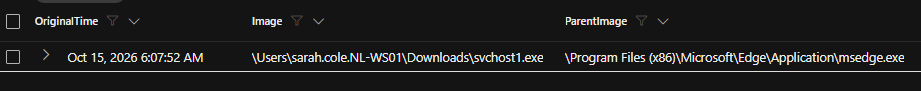

**The beacon.** Only one program on the host talks out on port 80, and it keeps looking up `egravy[.]com`.

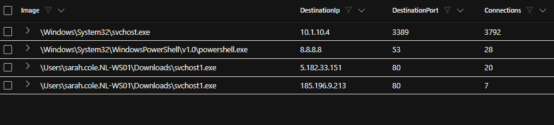
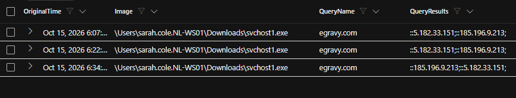
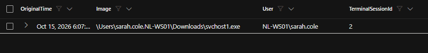

**The way in.** A network logon from `kali`, then a type 10 logon, which is the type Windows records for Remote Desktop.

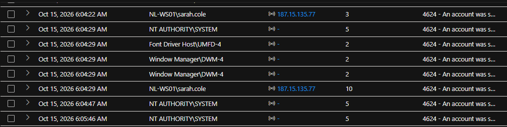
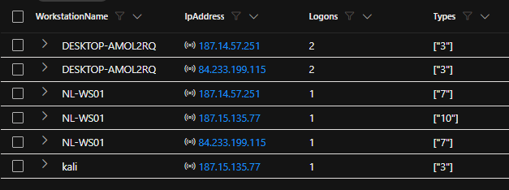

**The tell.** `ls` is a Linux command. Typing it into Windows `cmd` is a habit, not a script.

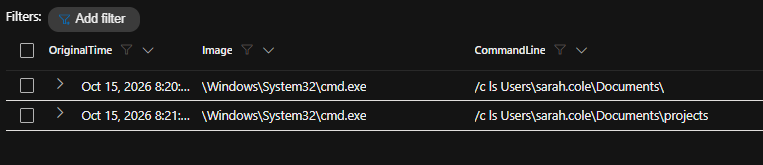

**Same file, two people.** At 10:01 the real user opened `passwords.txt` through Explorer. At 14:01 the attacker read it through the beacon. The process tree tells them apart.

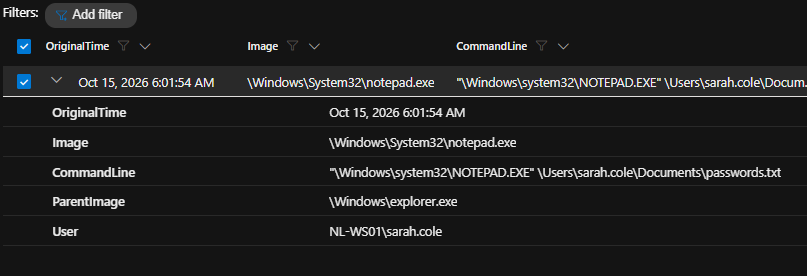
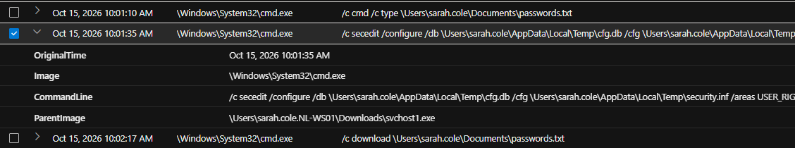
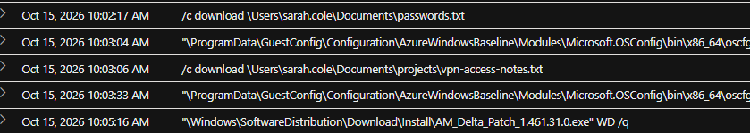

**Persistence.** A Run key named `image` pointing at `imageloader.exe` in a folder called `picture-loader` inside Pictures. Every name was picked to look like photo software.

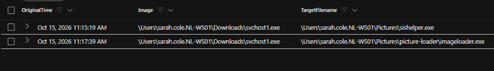
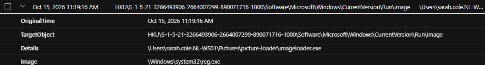

**Escalation failed.** No group change (4732) or rights change (4704) event exists. The only rows are the 6,986 failed logons from the spraying.

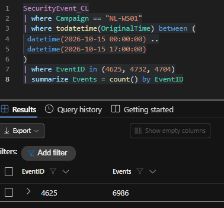

**No spread.** Both implants together only ever reached the two outside C2 addresses.

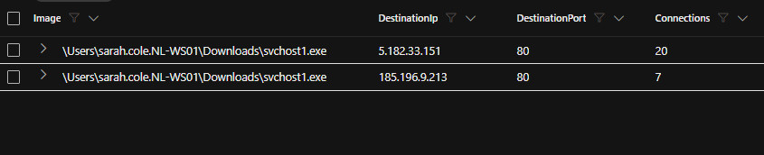

---

## Where the data disagreed with the brief

The range's own explanations didn't always match the logs. I went with the logs and said so in the report.

| The brief said | The data showed |
|---|---|
| The beacon connected 3 times and once | 27 connections in the window (20 and 7) |
| The window closes at 10:36 | Activity continues to 15:19; the window runs to 17:00 |
| Remote Desktop is inferred from NTLM | A type 10 logon proves it directly |
| No failed logons for `sarah.cole` | One, from her own address. The host took 6,986 others from sprayers |

I also flagged one thing a careful reader would catch: the logs record `download` as `cmd.exe /c download`, the same way they record `ls`, which `cmd` rejects. This range records Havoc commands that way, but read literally the downloads could have failed. `passwords.txt` was exposed anyway, because `type` had already sent its contents back through the beacon.

---

## Detections I wrote and tested

Every rule was replayed against the real hunt data, not just written down.

| ID | Catches | ATT&CK | Result on the hunt data |
|---|---|---|---|
| D1 | System process name running outside System32 (`svchost1.exe`) | T1036.005 | 1 hit |
| D2 | Browser launching an `.exe` from Downloads | T1105, T1204.002 | 1 hit |
| D3 | Shell or system tool started by a program in a user folder | T1059.003 | 18 hits |
| D4 | Run key pointing into a user folder | T1547.001 | 1 hit |
| D5 | Remote logon from a public address (`kali` raises it to High) | T1133, T1078.003 | 6 hits (2 attacker, 4 expected user) |
| D6 | `net localgroup ... /add` or `secedit /configure` | T1098.007 | 8 hits |
| D7 | Program in a user folder beaconing to public addresses | T1071.001 | 1 program, 27 connections |
| D8 | Correlation: D1 and D4 on the same host within 24 hours | Multiple | 1 hit |
| D9 | 20+ failed logons from one address in an hour | T1110.003 | 3 sprayers, never the attacker |

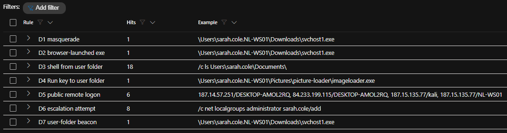
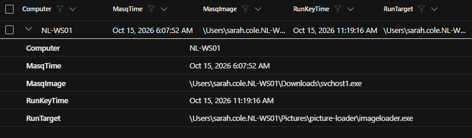
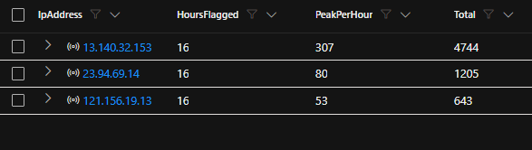

Example, D4 (persistence):

```kql
SysmonRegistryEvent_CL
| where todatetime(OriginalTime) > ago(1d)
| where EventType == "SetValue"
| where TargetObject has @"\CurrentVersion\Run"
| where Details has_any (@"\Downloads\", @"\Pictures\", @"\AppData\", @"\Temp\",
    @"\Public\", @"\Documents\")
| project OriginalTime, Computer, Image, TargetObject, Details
```

> **Lesson from D6:** my first draft used `has "localgroup"`. KQL `has` matches whole words, so it would have **missed the attacker's typo** `localgroups`. Switching to `contains` caught it. Attackers' mistakes are part of the signal, so detections must survive them.

> **Lesson from D9:** the password-spraying rule fired on three addresses and never on the real attacker. Burst alerts catch the noise; a valid stolen password walks straight past them. That is why the fix is multi-factor sign-in, not more alerting.

All rules are in [`detections/`](detections/), with the replay queries `V1` to `V3`.

---

## What should change

| Gap | Fix | How to prove the fix works |
|---|---|---|
| Remote Desktop open to the internet with only a password | Remote Desktop Gateway or VPN with multi-factor sign-in | External scan shows 3389 closed |
| One phished password was enough | Multi-factor sign-in for all remote access | Sign-in with the password alone is refused |
| Passwords and VPN details in plain text files | Password manager; rotate every secret in both files | Endpoint search for `passwords*.txt` returns nothing |
| Programs run freely from Downloads and Pictures | Application control (WDAC or AppLocker) | A test `.exe` in Downloads is blocked |
| No rule covered five hours of activity | Deploy D1 to D9 | Replay queries fire; a test Run key triggers D4 and D8 |
| Port 80 to a never-seen domain was allowed | Web proxy; block new and uncategorized domains | Request to a new test domain is blocked |
| No byte counts or file hashes in telemetry | Firewall logs with bytes; Sysmon SHA256 hashing | Events show bytes and hashes |
| 6,986 failed logons raised no alarm | Lockout policy; rename local Administrator; D9 | 25 bad passwords lock the test account and fire D9 |

---

## MITRE ATT&CK mapping

| Tactic | Technique |
|---|---|
| Initial Access | T1078.003 Valid Accounts: Local Accounts; T1133 External Remote Services; T1566.002 Spearphishing Link (suspected) |
| Execution | T1059.003 Windows Command Shell; T1204.002 User Execution (only if the user opened it) |
| Command and Control | T1071.001 Web Protocols; T1105 Ingress Tool Transfer |
| Defense Evasion | T1036.005 Match Legitimate Resource Name or Location; T1070.004 File Deletion; T1112 Modify Registry |
| Discovery | T1083 File and Directory Discovery; T1069.001 Local Groups |
| Privilege Escalation (failed) | T1098.007 Additional Local or Domain Groups |
| Credential Access | T1552.001 Credentials In Files |
| Collection / Exfiltration | T1005 Data from Local System; T1041 Exfiltration Over C2 Channel |
| Persistence | T1547.001 Registry Run Keys / Startup Folder |
| Checked, not seen | T1074 Data Staged; T1021 Lateral Movement |

---

## Indicators

Defanged so nothing here is clickable.

| Type | Indicator | Note |
|---|---|---|
| Domain | `egravy[.]com` | C2 |
| IP | `5.182.33[.]151`, `185.196.9[.]213` | C2, port 80 |
| IP | `187.15.135[.]77` | Attacker Remote Desktop source |
| Hostname | `kali` | Attacker client name |
| File | `\Downloads\svchost1.exe` | First implant |
| File | `\Pictures\picture-loader\imageloader.exe` | Persistent implant |
| File | `\Pictures\sishelper.exe` | Deleted first copy |
| Registry | `HKCU\Software\Microsoft\Windows\CurrentVersion\Run\image` | Persistence |

---

## Repository layout

```
wrong-shell-threat-hunt/
├── README.md                 this write-up
├── WrongShell_Report.pdf     full threat hunt report (public TLP:CLEAR copy)
├── detections/               D1 to D9 rules and V1 to V3 replay queries (.kql)
├── queries/hunt-queries.kql  every hunt and follow-up query
└── images/                   screenshots from the hunt
```

---

## What I learned

- **Start from the alert and pivot one question at a time.** Network, then DNS, then the process, then the logon, then everything the process launched.
- **Know what "normal" looks like.** The fake `svchost` was obvious only because I knew the real one's folder, parent, account and session.
- **The same file can be touched by two people.** The process tree, not the file name, decides who is the attacker.
- **Trust the data over the brief.** Four of the range's explanations didn't match the logs, and saying so made the report stronger.
- **Test detections, and test them against the attacker's mistakes.** A typo nearly slipped past my own rule.
- **Noise is not the threat.** Thousands of failed logons hid one quiet, valid logon.

---

**Author:** Tural Aghabalayev · [GitHub](https://github.com/cyberagha0) · [LinkedIn](https://linkedin.com/in/tural-aghabalayev)
